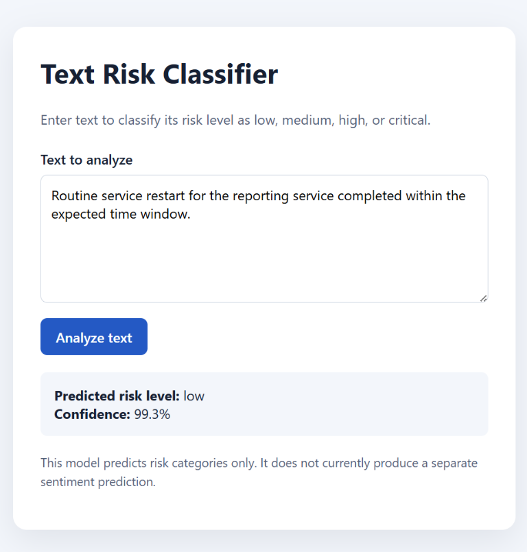

# Text Sentiment & Risk Classifier

This project is a small machine learning app that classifies short text into a risk level such as low, medium, high, or critical. It is designed for messages like security alerts, system warnings, login issues, and unusual operational events.

## App snapshot



## Project architecture
The project has three main parts:
- `data/sample_dataset.csv`: sample labeled text data
- `src/train.py`: trains the model and saves it
- `src/app.py`: loads the saved model and exposes a FastAPI API for predictions

The model uses a TF-IDF vectorizer and a Logistic Regression classifier from scikit-learn. The trained model is stored in `models/classifier.joblib`.

## Example
Request:

```json
{
  "text": "Unauthorized access attempt detected in the system logs."
}
```

Response:

```json
{
  "text": "Unauthorized access attempt detected in the system logs.",
  "predicted": "high",
  "confidence_score": 0.8721
}
```

## Dataset
The dataset is stored in `data/sample_dataset.csv` and contains:
- `text`: the input message
- `label`: the risk category for that message

The labels used are:
- `low`
- `medium`
- `high`
- `critical`

## Requirements
Install the required Python packages:

```bash
pip install -r requirements.txt
```

Dependencies include:
- pandas
- scikit-learn
- fastapi
- uvicorn
- joblib
- pydantic

## Model setup
Train the model with:

```bash
python src/train.py
```

This script loads the dataset, trains the classifier, and saves the model to:

```text
models/classifier.joblib
```

## Run the project
1. Create a virtual environment:

```bash
python -m venv .venv
.venv\Scripts\activate
```

2. Install dependencies:

```bash
pip install -r requirements.txt
```

3. Train the model:

```bash
python src/train.py
```

4. Start the API:

```bash
uvicorn src.app:app --host 0.0.0.0 --port 8000 --reload
```

5. Open the browser at:

```text
http://127.0.0.1:8000/
```

You can also send requests directly to the `/predict` endpoint using curl or Postman.
